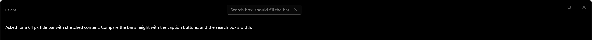

# windows-reactor: no way to make a TitleBar taller than `Tall`, or stretch its content

The goal is a 64 px title bar with a search box that fills the space between the title and the caption buttons.

## Run

From the repository root:

```
cargo run -p repro-titlebar-height
```

Pinned to `microsoft/windows-rs` master `0496ec1` (2026-10-24) in the workspace `Cargo.toml`. No other dependencies.

## What happens

The title bar uses `preferred_height(WindowTitleBarHeight::Tall)` and `height(64.0)`:

- `height` makes the element taller, but the caption buttons keep the `Tall` (48 px) height. WinUI takes the bar's height from the `TitleBarExpandedHeight` theme resource, which `height` doesn't change.
- The content stays centred at its natural width. WinUI takes that from `TitleBarContentHorizontalAlignment`.



Both are theme resources, and lightweight styling is how WinUI expects them to be changed. Reactor supports that for `Button` and `Expander` (`resource_overrides`), but `TitleBar` has no `resource_overrides`, and `ResourceValue` has no variant for `x:Double` or for an alignment.

Environment: Windows 11 (build 26340), Windows App SDK 2.x, Rust 1.97.1, 150% display scale.
